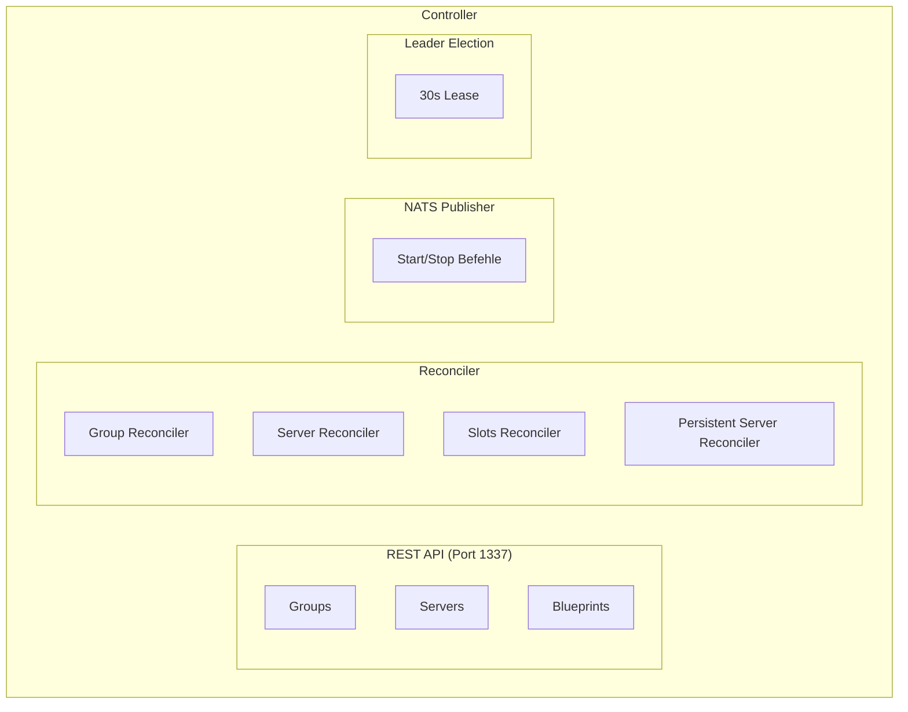
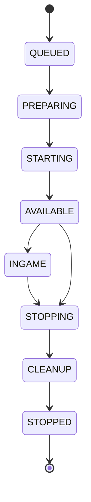

## Was ist der Controller?

Der Controller ist das Gehirn von SimpleCloud - ein verteilter Orchestrierungsdienst, der den gewünschten Zustand deiner Minecraft-Infrastruktur verwaltet. Er koordiniert Serverhosts, pflegt Konfigurationen und stellt APIs für die Verwaltung bereit.

## Hauptaufgaben

### Zustandsverwaltung

Der Controller pflegt den autoritativen Zustand von:

- **Networks** - Registrierte Minecraft-Netzwerke mit Credentials
- **Blueprints** - Server-Konfigurationsvorlagen
- **Groups** - Skalierbare Server-Sammlungen mit Auto-Scaling-Regeln
- **Servers** - Laufende Server-Instanzen und deren Status
- **Persistent Servers** - Langlebige dedizierte Server
- **Serverhosts** - Verbundene Ausführungsagenten
- **Plugins** - Plugin-Definitionen und Zuweisungen

### Reconciliation Loop

Der Controller gleicht kontinuierlich gewünschten mit aktuellem Zustand ab:

1. Vergleicht alle 5 Sekunden Konfiguration mit laufenden Servern
2. Bestimmt, welche Server gestartet oder gestoppt werden müssen
3. Wählt optimale Serverhosts basierend auf Kapazität und Präferenzen
4. Sendet Befehle an Serverhosts via NATS-Messaging
5. Verarbeitet Status-Updates von Serverhosts

### API-Dienste

Der Controller stellt eine REST-API auf Port 1337 bereit:

| Endpoint | Beschreibung |
|----------|--------------|
| `/v0/server-groups` | Gruppen-Verwaltung |
| `/v0/servers` | Server-Operationen |
| `/v0/persistent-servers` | Persistente Server-Verwaltung |
| `/v0/blueprints` | Blueprint-Konfiguration |
| `/v0/serverhosts` | Serverhost-Registrierung |
| `/v0/plugins` | Plugin-Verwaltung |
| `/v0/networks` | Netzwerk-Registrierung |

API-Dokumentation ist verfügbar unter `http://localhost:1337/swagger/index.html`.

## Architektur



## Verteiltes Design

### Leader Election

Mehrere Controller-Instanzen können gleichzeitig für Hochverfügbarkeit laufen:

- Datenbankgestützte Konsensbildung mit 30-Sekunden-Lease
- Nur der Leader führt Netzwerkzuweisungen und kritische Operationen durch
- Automatisches Failover, wenn der Leader nicht verfügbar wird
- Alle Instanzen können API-Anfragen bedienen

### Netzwerk-Zuweisung

Netzwerke werden über Controller verteilt:

- Jedes Netzwerk wird einem Controller für Lifecycle-Management zugewiesen
- Zuweisung berücksichtigt Controller-Last und Serverhost-Konnektivität
- Automatische Neuzuweisung, wenn ein Controller inaktiv wird

## Server-Lebenszyklus

Server folgen dieser Zustandsmaschine:



| Zustand | Beschreibung |
|---------|--------------|
| `QUEUED` | Wartet auf Scheduling |
| `PREPARING` | Serverhost bereitet Dateien vor |
| `STARTING` | Server-Prozess startet |
| `AVAILABLE` | Bereit für Spieler |
| `INGAME` | Läuft mit Spielern |
| `STOPPING` | Graceful Shutdown |
| `CLEANUP` | Ressourcen werden entfernt |
| `STOPPED` | Server beendet |

## Auto-Scaling

Der Controller unterstützt automatische Skalierung basierend auf:

### Slot-basierte Skalierung

Skalierung basierend auf verfügbaren Spieler-Slots:

```yaml
scaling:
  mode: SLOTS
  min_servers: 1
  max_servers: 5
  player_threshold: 0.8  # Skaliert hoch bei 80% Auslastung
```

### Server-basierte Skalierung

Feste Anzahl von Servern beibehalten:

```yaml
scaling:
  mode: SERVER
  min_servers: 2
  max_servers: 2
```

## Kommunikation

### NATS Topics

Der Controller nutzt NATS für Serverhost-Kommunikation:

| Topic-Muster | Zweck |
|--------------|-------|
| `{networkId}.serverhost.{id}.start` | Server-Start-Anfrage |
| `{networkId}.server.{id}.status` | Server-Status-Updates |
| `{networkId}.server.{id}.stopped` | Server-gestoppt-Events |
| `{networkId}.internal.serverhost.{id}.keep-alive` | Health Checks |

### Keep-Alive Protokoll

Serverhosts senden periodische Keep-Alive-Nachrichten:

- Controller verfolgt letzten Heartbeat pro Serverhost
- Inaktive Serverhosts werden als nicht verfügbar markiert
- Controller kann Serverhost-Updates anfordern

## Infrastruktur-Anforderungen

| Komponente | Zweck | Erforderlich |
|------------|-------|--------------|
| PostgreSQL | Zustandspersistenz | Ja |
| NATS | Serverhost-Messaging | Ja |
| Valkey/Redis | Metriken-Caching | Optional |
| ClickHouse | Log-Speicherung | Optional |

## Zugriff auf den Controller

### Via CLI

```bash
# Controller-Status prüfen
sc status

# Controller-Logs anzeigen
sc logs controller

# An Controller-Konsole anhängen
sc attach controller
```

### Via API

```bash
# Alle Gruppen auflisten
curl -H "X-Network-ID: dein-netzwerk" \
     -H "X-Network-Secret: dein-secret" \
     http://localhost:1337/v0/server-groups

# Server starten
curl -X POST \
     -H "X-Network-ID: dein-netzwerk" \
     -H "X-Network-Secret: dein-secret" \
     -H "Content-Type: application/json" \
     -d '{"group_id": "lobby"}' \
     http://localhost:1337/v0/servers
```

## Hochverfügbarkeit

Für Produktionsumgebungen:

- Mehrere Controller-Instanzen hinter einem Load Balancer betreiben
- Managed PostgreSQL mit Replikation verwenden
- NATS-Clustering für Nachrichtenzuverlässigkeit konfigurieren
- Valkey/Redis für verteiltes Caching aktivieren

<Note>
  Der Controller muss laufen, damit neue Server starten können. Bestehende Server
  laufen weiter, wenn der Controller temporär offline ist.
</Note>
