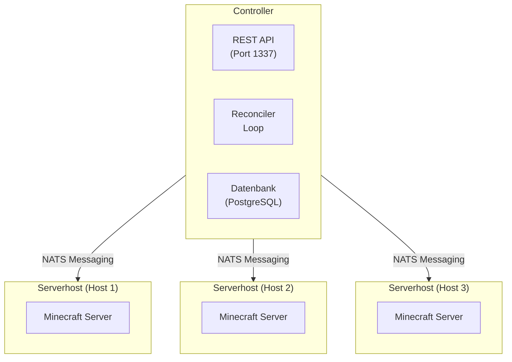

## SimpleCloud v3 verstehen

SimpleCloud v3 basiert auf einer verteilten Microservices-Architektur, die für Skalierbarkeit und Zuverlässigkeit entwickelt wurde. Das System trennt Orchestrierung (Controller) von Ausführung (Serverhost), sodass du deine Minecraft-Infrastruktur über mehrere Maschinen skalieren kannst.

## Kernkomponenten

### Controller

Der [Controller](/de/manual/architecture/controller) ist der zentrale Orchestrierungsdienst, der:

- Den gewünschten Zustand deiner Infrastruktur verwaltet
- Gruppen, Blueprints, Server und persistente Server handhabt
- REST-APIs für Verwaltung und Integration bereitstellt
- Serverhosts über NATS-Messaging koordiniert
- Horizontale Skalierung mit Leader Election unterstützt

### Serverhost

Der [Serverhost](/de/manual/architecture/serverhost) ist der Ausführungsagent, der:

- Auf jeder Maschine läuft, die Minecraft-Server hostet
- Den Server-Lebenszyklus verwaltet (Vorbereitung, Start, Stop, Cleanup)
- Workflows für Server-Setup ausführt
- Mehrere Runner unterstützt (Screen/Tmux, Docker)
- Plugin-Installation und Konfiguration übernimmt

### CLI

Die [CLI](/de/manual/architecture/cli) bietet:

- Interaktives Setup und Konfiguration
- Komponenten-Lifecycle-Management
- Gruppen- und Server-Verwaltung
- Context-Wechsel für mehrere Umgebungen

## Architektur-Diagramm

## Schlüsselkonzepte

### Blueprints

Blueprints sind Server-Vorlagen, die definieren:

- Minecraft-Version und Server-Software (Paper, Velocity, etc.)
- Laufzeitkonfiguration (Java-Version, JVM-Argumente)
- Workflow-Schritte für Server-Vorbereitung
- Configurator-Einstellungen

Blueprints sind wiederverwendbar - mehrere Gruppen können denselben Blueprint referenzieren.

### Gruppen

Gruppen definieren skalierbare Server-Sammlungen mit:

- Ressourcenzuweisung (Speicher, Max-Spieler)
- Auto-Scaling-Regeln (Min/Max-Server, Spieler-Schwellenwert)
- Deployment-Strategie (welche Serverhosts verwendet werden)
- Referenz zu einem Blueprint oder Container-Image

### Server

Server sind einzelne laufende Instanzen:

- Werden dynamisch aus Gruppen basierend auf Scaling-Regeln erstellt
- Haben eindeutige Identifikatoren und zugewiesene Ports
- Melden Metriken (Spieleranzahl, Speichernutzung)
- Folgen einem Lebenszyklus: Queued → Preparing → Starting → Available → Stopping

### Persistente Server

Persistente Server sind langlebige Instanzen, die:

- Zustand über Neustarts hinweg beibehalten
- An bestimmte Serverhosts gebunden sind
- Nicht automatisch skalieren
- Ideal für Survival-Welten, Build-Server oder Lobbys mit persistenten Daten

### Plugins

Plugins können Gruppen oder persistenten Servern zugewiesen werden:

- Automatischer Download von Modrinth, Hangar oder Spigot
- Versions- und plattformbewusste Installation
- Gecached für schnelleren Server-Start

## Datenfluss

1. **Konfiguration**: Du definierst Blueprints, Gruppen und Plugins über CLI oder API
2. **Reconciliation**: Controller vergleicht gewünschten mit aktuellem Zustand alle 5 Sekunden
3. **Scheduling**: Controller bestimmt, welche Server zu starten/stoppen sind und auf welchem Serverhost
4. **Kommunikation**: Controller sendet Anfragen an Serverhosts via NATS
5. **Ausführung**: Serverhost bereitet vor und startet den Server
6. **Reporting**: Serverhost meldet Server-Status zurück an Controller

## Infrastruktur

SimpleCloud verwendet diese Infrastrukturkomponenten:

| Komponente | Zweck |
|------------|-------|
| PostgreSQL | Persistente Zustandsspeicherung |
| NATS | Message Broker für Serverhost-Kommunikation |
| Valkey/Redis | Metriken-Caching (optional) |
| ClickHouse | Log- und Metriken-Speicherung (optional) |

## Nächste Schritte

- [Controller](/de/manual/architecture/controller) - Tiefere Einblicke in den Orchestrierungsdienst
- [Serverhost](/de/manual/architecture/serverhost) - Lerne über Server-Ausführung
- [CLI](/de/manual/architecture/cli) - Entdecke die Kommandozeilen-Verwaltung
