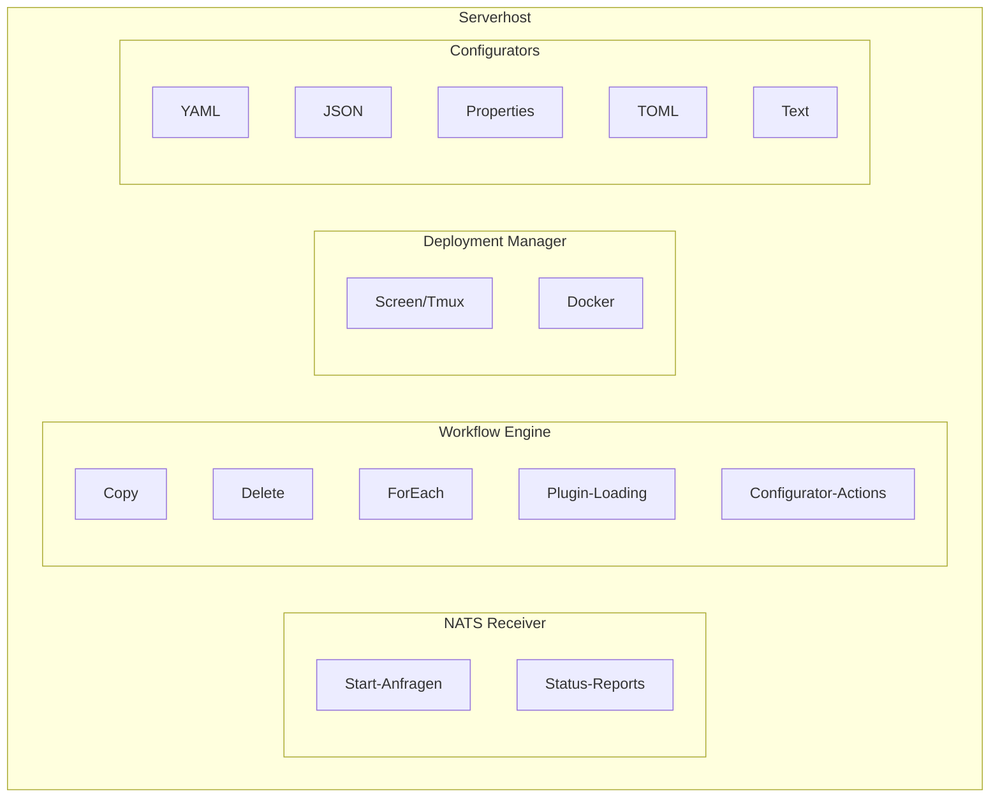
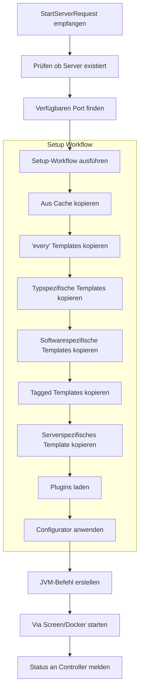

## Was ist der Serverhost?

Der Serverhost ist ein verteilter Ausführungsagent, der auf jeder Maschine in deiner SimpleCloud-Infrastruktur läuft. Er empfängt Befehle vom Controller und verwaltet den tatsächlichen Lebenszyklus von Minecraft-Servern - von der Vorbereitung über die Ausführung bis zum Cleanup.

## Hauptaufgaben

### Server-Lebenszyklus

Der Serverhost verwaltet den kompletten Server-Lebenszyklus:

1. **Vorbereitung** - Workflows ausführen, Templates kopieren, Plugins installieren
2. **Konfiguration** - Configurators anwenden für Ports, Secrets, etc.
3. **Ausführung** - Server-Prozess starten (Screen/Tmux oder Docker)
4. **Monitoring** - Server-Health verfolgen und Logs streamen
5. **Cleanup** - Prozess stoppen und temporäre Dateien entfernen

### Workflow-Ausführung

Workflows definieren den Server-Vorbereitungsprozess:

- Template-Dateien ins Server-Verzeichnis kopieren
- Plugins von Registries herunterladen und installieren
- Konfiguration basierend auf Server-Software anwenden
- Benutzerdefinierte Setup-Schritte ausführen

### Plugin-Verwaltung

Automatische Plugin-Installation aus mehreren Quellen:

| Quelle | Beschreibung |
|--------|--------------|
| Modrinth | Moderne Plugin/Mod-Registry |
| Hangar | PaperMCs Plugin-Repository |
| Spigot | SpigotMC-Ressourcenseiten |
| URL | Direkter Download von beliebiger HTTP(S)-URL |

## Architektur



## Ausführungsmodi

### Screen/Tmux (Lokal)

Der Standard-Ausführungsmodus mit Terminal-Multiplexern:

- **Screen** - Bevorzugt, weit verbreitet auf Linux
- **Tmux** - Alternative wenn Screen nicht verfügbar

SimpleCloud-Komponenten laufen als detached Prozesse mit Komponenten-Konsolenzugriff via:

```bash
# An die Serverhost-Komponenten-Konsole anhängen
sc attach serverhost
```

### Docker

Container-basierte Ausführung für Isolation:

- Jeder Server läuft in eigenem Container
- Ressourcenlimits durch Docker erzwungen
- Bessere Isolation zwischen Servern
- Docker muss installiert sein

Runner-Modus beim Starten konfigurieren:

```bash
sc start --runner docker
sc start --runner screen
```

## Verzeichnisstruktur

<Tree>
  <Tree.Folder name="secrets" defaultOpen>
    <Tree.File name="network-id.key" />
    <Tree.File name="network-secret.key" />
    <Tree.File name="serverhost-id.key" />
  </Tree.Folder>
  <Tree.Folder name="workflows" defaultOpen>
    <Tree.Folder name="internal" defaultOpen>
      <Tree.File name="setup.yml" />
      <Tree.File name="cleanup.yml" />
    </Tree.Folder>
  </Tree.Folder>
  <Tree.Folder name="options" defaultOpen>
    <Tree.Folder name="configurators">
      <Tree.File name="paper_velocity.yml" />
      <Tree.File name="velocity.yml" />
    </Tree.Folder>
    <Tree.File name="modrinth-platform-mappings.yml" />
  </Tree.Folder>
  <Tree.Folder name="templates" defaultOpen>
    <Tree.Folder name="every" />
    <Tree.Folder name="every_proxy" />
    <Tree.Folder name="every_server" />
    <Tree.Folder name="every_paper" />
    <Tree.Folder name="every_velocity" />
    <Tree.Folder name="_tagged">
      <Tree.Folder name="minigames" />
    </Tree.Folder>
    <Tree.Folder name="cache" />
  </Tree.Folder>
  <Tree.Folder name="running" />
  <Tree.Folder name="logs" />
</Tree>

## Template-Hierarchie

Templates werden der Reihe nach angewendet, wobei spätere Templates frühere überschreiben:

| Reihenfolge | Verzeichnis | Beschreibung |
|-------------|-------------|--------------|
| 1 | `every/` | Basisdateien für alle Server |
| 2 | `every_{type}/` | Typspezifisch (z.B. `every_proxy/`) |
| 3 | `every_{software}/` | Softwarespezifisch (z.B. `every_paper/`) |
| 4 | `_tagged/{tag}/` | Für jeden Tag der Gruppe |
| 5 | `{server-name}/` | Serverspezifische Templates |
| 6 | `cache/{group}/` | Gecachte Dateien von vorherigen Starts |

## Kommunikation

### NATS Messaging

Der Serverhost kommuniziert mit dem Controller via NATS:

**Eingehend (vom Controller):**
- `{networkId}.serverhost.{id}.start` - Server-Start-Anfrage

**Ausgehend (zum Controller):**
- `{networkId}.server.{id}.status` - Server-Status-Updates
- `{networkId}.server.{id}.logs` - Log-Streaming
- `{networkId}.internal.serverhost.{id}.keep-alive` - Health Checks

### Zustandssynchronisation

Jede Minute führt der Serverhost durch:

1. Aktive Server vom Controller abrufen
2. Mit lokal laufenden Servern vergleichen
3. Verwaiste Server stoppen, die nicht im Controller-Zustand sind

## Server-Vorbereitungsablauf

Wenn eine Start-Anfrage eintrifft:



## Konfiguration

Serverhost-Setup verwendet die aktuellen CLI-Setup-Optionen:

| Parameter | Beschreibung | Standard |
|-----------|--------------|----------|
| `--network` | Network-ID oder Slug | Interaktive Auswahl |
| `--install-dir` | Serverhost-Installationsverzeichnis | Interaktive Abfrage |
| `--host-name` | Anzeigename des Serverhosts | Interaktive Abfrage |
| `--max-memory` | Maximaler Serverhost-Speicher, z. B. `80%` oder `32gb` | Aus Systemspeicher erkannt |
| `--start` / `--no-start` | SimpleCloud nach dem Setup starten oder Start überspringen | Interaktive Abfrage |
| `--auto-install-deps` / `--no-auto-install-deps` | Erforderliche Abhängigkeiten automatisch installieren oder Installation überspringen | Interaktive Abfrage |
| `--install` | Setup-Installables installieren, z. B. `--install java:21` | Keine |
| `-y, --yes` | Wo möglich nicht-interaktive Defaults verwenden | `false` |

## Monitoring

### Via CLI

```bash
# Serverhost-Status prüfen
sc status serverhost

# Serverhost-Logs anzeigen
sc logs serverhost

# Spezifische Server-Logs anzeigen
sc server logs <group> <id>
```

### Keep-Alive

Der Serverhost sendet periodische Keep-Alive-Nachrichten:

- Meldet aktuelle Version
- Meldet installierte Java-Runtime-Versionen (als `installed_java_versions` in den Serverhost-API-Antworten verfügbar)
- Empfängt Update-Benachrichtigungen
- Hält Verbindung zum Controller aufrecht

<Note>
  Serverhosts starten Server automatisch neu, wenn der Serverhost selbst neu startet,
  basierend auf der Synchronisation mit dem Controller-Zustand.
</Note>

## Verwandte Themen

- [Configurators](/de/manual/configuration/configurators) - Server-Konfigurationssystem
- [Workflows](/de/manual/configuration/workflows) - Server-Vorbereitungs-Workflows
