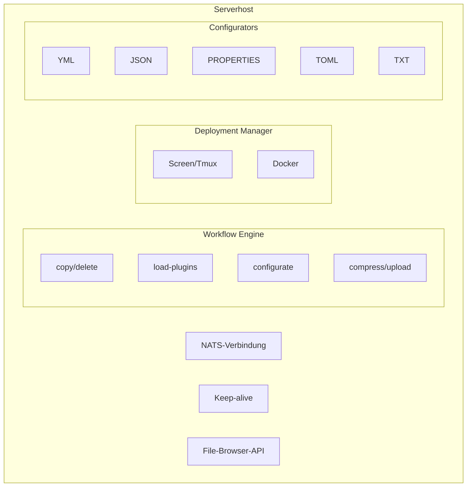
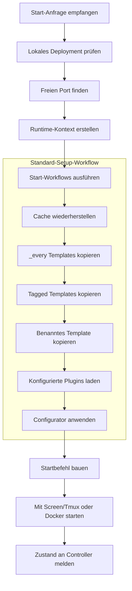

## Was der Serverhost macht

Der Serverhost läuft auf jeder Maschine, die Minecraft-Server für dein SimpleCloud-Netzwerk starten soll. Er verbindet sich mit dem Controller, empfängt Start-Anfragen, bereitet Serverdateien vor, startet den Serverprozess, meldet Zustände und räumt nach gestoppten dynamischen Servern auf.

## Aufgaben

### Server-Lebenszyklus

Der Serverhost verwaltet den lokalen Lebenszyklus jedes Servers:

1. **Vorbereitung** - Start-Workflows ausführen, Templates kopieren und konfigurierte Plugins laden
2. **Konfiguration** - Configurators für Ports, Forwarding-Secrets, Spielerlimits und weitere Dateien anwenden
3. **Ausführung** - Den Server mit dem konfigurierten Runner starten
4. **Monitoring** - Den lokalen Prozess überwachen, Logs weiterleiten und Zustände melden
5. **Cleanup** - Stop-Workflows ausführen und temporäre Verzeichnisse dynamischer Server entfernen

### Workflow-Ausführung

Workflows definieren Vorbereitung und Cleanup. Der Standard-Setup-Workflow kopiert Cache-Daten, gemeinsame Templates, Tag-Templates und das benannte Template, bevor er Plugins lädt und den ausgewählten Configurator anwendet.

### Plugin-Loading

Der Serverhost kann konfigurierte Plugins aus mehreren Quellen laden:

| Quelle | Beschreibung |
| ------ | ------------ |
| Modrinth | Plugin- oder Mod-Versionen von Modrinth |
| Hangar | PaperMC-Hangar-Projekte |
| Spigot | SpigotMC-Ressourcen |
| URL | Direkter HTTP(S)-Download |

## Architektur



## Runner-Modi

### Screen oder Tmux

Der lokale Runner startet Server als detached Prozesse über einen Terminal-Multiplexer.

```bash
sc start --runner screen
```

Mit `sc attach serverhost` kannst du dich an die Serverhost-Komponenten-Konsole anhängen.

### Docker

Der Docker-Runner startet jeden Server in einem eigenen Container. Nutze ihn, wenn du stärkere Prozessisolation und Docker-gesteuerte Ressourcenlimits möchtest.

```bash
sc start --runner docker
```

Docker muss auf der Serverhost-Maschine installiert sein.

## Verzeichnisstruktur

<Tree>
  <Tree.Folder name="secrets" defaultOpen>
    <Tree.File name="network-id.key" />
    <Tree.File name="network-secret.key" />
    <Tree.File name="serverhost-id.key" />
  </Tree.Folder>
  <Tree.Folder name="options" defaultOpen>
    <Tree.Folder name="configurators">
      <Tree.File name="paper_velocity.yml" />
      <Tree.File name="velocity.yml" />
    </Tree.Folder>
    <Tree.File name="platform-mappings.yml" />
  </Tree.Folder>
  <Tree.Folder name="workflows" defaultOpen>
    <Tree.Folder name="internal">
      <Tree.File name="setup.yml" />
      <Tree.File name="cleanup.yml" />
    </Tree.Folder>
  </Tree.Folder>
  <Tree.Folder name="templates" defaultOpen>
    <Tree.Folder name="_every">
      <Tree.Folder name="every" />
      <Tree.Folder name="every_proxy" />
      <Tree.Folder name="every_server" />
      <Tree.Folder name="every_paper" />
      <Tree.Folder name="every_velocity" />
    </Tree.Folder>
    <Tree.Folder name="_tagged">
      <Tree.Folder name="minigames" />
    </Tree.Folder>
    <Tree.Folder name="lobby" />
    <Tree.Folder name="cache" />
  </Tree.Folder>
  <Tree.Folder name="running" />
  <Tree.Folder name="logs" />
</Tree>

## Server-Vorbereitung

Wenn eine Start-Anfrage eintrifft:



Dynamische Gruppenserver nutzen temporäre Verzeichnisse unter `running/`. Persistente Server behalten ihr Laufzeitverzeichnis zwischen Neustarts.

## Kommunikation

Der Serverhost kommuniziert mit dem Controller über NATS und Controller-HTTP-APIs:

| Kanal | Zweck |
| ----- | ----- |
| Start-Anfragen | Der Controller beauftragt einen bestimmten Serverhost mit einem Serverstart |
| Keep-alive | Der Serverhost meldet Version, Laufzeit und installierte Java-Versionen |
| Server-Events | Der Serverhost meldet Starting-, Stopped- und Cleanup-complete-Events |
| Log-Weiterleitung | Der Serverhost leitet Serverlogs für Dashboard und CLI weiter |
| File-Browser-API | Das Dashboard kann erlaubte Serverhost-Dateien anzeigen und bearbeiten |

Jeder Serverhost synchronisiert außerdem den Controller-Zustand und stoppt lokale verwaiste Server, die nicht mehr zum Controller-Zustand gehören.

## Setup-Optionen

Serverhost-Setup verwendet die aktuellen CLI-Setup-Optionen:

| Option | Beschreibung |
| ------ | ------------ |
| `--network` | Network-ID oder Slug |
| `--install-dir` | Serverhost-Installationsverzeichnis |
| `--host-name` | Anzeigename des Serverhosts |
| `--max-memory` | Maximaler Speicher für Serverprozesse, zum Beispiel `80%` oder `32gb` |
| `--start` / `--no-start` | SimpleCloud nach dem Setup starten oder Start überspringen |
| `--auto-install-deps` / `--no-auto-install-deps` | Erforderliche Abhängigkeiten automatisch installieren oder Installation überspringen |
| `--install` | Setup-Installables installieren, zum Beispiel `--install java:21` |
| `-y, --yes` | Wo möglich nicht-interaktive Defaults verwenden |

## Monitoring

```bash
# Serverhost-Status prüfen
sc status serverhost

# Serverhost-Logs anzeigen
sc logs serverhost

# Serverlog anzeigen
sc server logs <group> <id>
```

<Note>
  Wenn ein Serverhost neu startet, vergleicht er lokale Deployments mit dem Controller-Zustand und hängt sich, wo möglich, wieder an Server an, die weiterhin ihm gehören.
</Note>

## Verwandte Themen

- [Templates](/de/manual/setup/templates) - Template-Hierarchie und Dateilayout
- [Configurators](/de/manual/configuration/configurators) - Server-Konfigurationssystem
- [Workflows](/de/manual/configuration/workflows) - Server-Vorbereitungs- und Cleanup-Workflows
