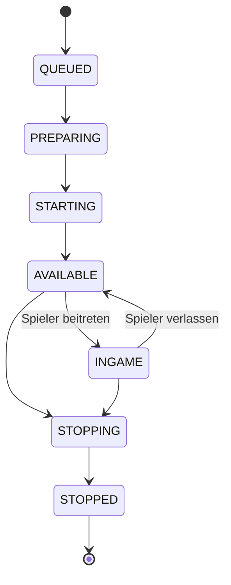

Ein Server ist eine laufende Minecraft-Instanz - der tatsächliche Java-Prozess, mit dem sich Spieler verbinden. Server sind standardmäßig kurzlebig: sie existieren nur während der Ausführung und können nach Bedarf erstellt oder zerstört werden.

Jeder Server gehört entweder zu einer [Gruppe](/de/manual/setup/server-groups) oder einem [Persistenten Server](/de/manual/setup/persistent-servers).

## Wie Server erstellt werden

### Aus Gruppen

Gruppen erstellen Server automatisch basierend auf Spielerbedarf:

- Auto-Scaling startet neue Server wenn Spieler beitreten und entfernt inaktive wenn die Nachfrage sinkt
- Mindestanzahl stellt sicher, dass Server immer verfügbar sind, auch ohne Spieler
- Mehrere Instanzen laufen gleichzeitig (Lobby-1, Lobby-2, Lobby-3, etc.)
- Du kannst bei Bedarf auch manuell zusätzliche Server starten

### Aus Persistenten Servern

Persistente Server sind Einzel-Instanzen, die nicht skalieren:

- Immer der gleiche Server - nur an oder aus
- Behält seine Welt und Daten zwischen Neustarts
- Ideal für Spielmodi wie Skyblock, SMP oder Citybuild

## Server-Lebenszyklus

Jeder Server durchläuft diese Zustände:

| Zustand | Beschreibung |
|---------|--------------|
| **Queued** | Wartet auf Zuweisung eines Server-Hosts |
| **Preparing** | Template-Dateien werden ins Laufzeitverzeichnis kopiert |
| **Starting** | JVM-Prozess startet, Plugins laden |
| **Available** | Bereit für Spieler, beim Proxy registriert |
| **Ingame** | Hat aktive Spieler verbunden |
| **Stopping** | Graceful Shutdown läuft |
| **Stopped** | Prozess beendet, Laufzeitverzeichnis aufgeräumt |

## Server-Eigenschaften

- Jeder Server erbt Eigenschaften von seiner Gruppen- oder Persistenten-Server-Konfiguration
- Instanz-spezifische Eigenschafts-Überschreibungen sind zur Laufzeit möglich
- Eigenschaften sind für Plugins über die Cloud API und als Umgebungsvariablen verfügbar

## Server-Host-Zuweisung

Server laufen nicht im Vakuum - sie werden Server-Hosts zugewiesen:

- Der Controller weist Server Hosts basierend auf Deployment-Einstellungen zu
- Prioritätsreihenfolge bestimmt, welcher Host bevorzugt wird wenn mehrere verfügbar sind
- Jeder Server läuft in seinem eigenen isolierten Verzeichnis auf dem Host
