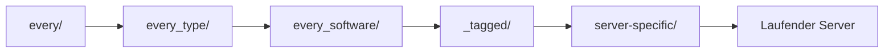

Templates sind die Dateistrukturen, die auf neue Server-Instanzen kopiert werden. Sie enthalten die Plugins, Konfigurationen und Standard-Weltdateien deines Servers.

## Wie Templates funktionieren

Wenn SimpleCloud einen Server startet, werden Templates in einer bestimmten Reihenfolge angewendet. Jede Ebene kann Dateien von vorherigen Ebenen hinzufügen oder überschreiben, was dir flexible Kontrolle über deine Server-Konfigurationen gibt.



<Note>
  Brauchst du persistente Daten, die Neustarts überleben? Verwende einen [Persistenten Server](/de/manual/setup/persistent-servers) anstelle einer Gruppe.
</Note>

## Template-Verzeichnisstruktur

<Tree>
  <Tree.Folder name="templates" defaultOpen>
    <Tree.Folder name="every" defaultOpen>
      <Tree.File name="Wird auf ALLE Server angewendet" />
    </Tree.Folder>
    <Tree.Folder name="every_proxy">
      <Tree.File name="Wird auf alle Proxy-Server angewendet" />
    </Tree.Folder>
    <Tree.Folder name="every_server">
      <Tree.File name="Wird auf alle Game-Server angewendet" />
    </Tree.Folder>
    <Tree.Folder name="every_paper">
      <Tree.File name="Wird auf alle Paper-Server angewendet" />
    </Tree.Folder>
    <Tree.Folder name="every_velocity">
      <Tree.File name="Wird auf alle Velocity-Server angewendet" />
    </Tree.Folder>
    <Tree.Folder name="_tagged" defaultOpen>
      <Tree.Folder name="minigames">
        <Tree.File name="Wird auf Server mit 'minigames' Tag angewendet" />
      </Tree.Folder>
      <Tree.Folder name="premium">
        <Tree.File name="Wird auf Server mit 'premium' Tag angewendet" />
      </Tree.Folder>
    </Tree.Folder>
    <Tree.Folder name="lobby">
      <Tree.File name="Wird nur auf 'lobby' Gruppe angewendet" />
    </Tree.Folder>
    <Tree.Folder name="bedwars">
      <Tree.File name="Wird nur auf 'bedwars' Gruppe angewendet" />
    </Tree.Folder>
    <Tree.Folder name="cache">
      <Tree.File name="Gecachte Dateien für schnellere Neustarts" />
    </Tree.Folder>
  </Tree.Folder>
</Tree>

## Template-Hierarchie

Templates werden der Reihe nach angewendet. Spätere Templates überschreiben frühere:

| Reihenfolge | Verzeichnis | Beschreibung |
|-------------|-------------|--------------|
| 1 | `every/` | Basisdateien für alle Server |
| 2 | `every_{type}/` | Typspezifisch (`every_proxy/`, `every_server/`) |
| 3 | `every_{software}/` | Softwarespezifisch (`every_paper/`, `every_velocity/`) |
| 4 | `_tagged/{tag}/` | Tag-basierte Templates |
| 5 | `{group-name}/` | Gruppenspezifische Templates |
| 6 | `cache/{group}/` | Gecachte Dateien von vorherigen Starts |

### Beispiel: Wie ein Lobby-Server aufgebaut wird

Für einen Server in der `lobby` Gruppe mit Paper-Software und dem `premium` Tag:

1. **`every/`** - Basis-Plugins wie SimpleCloud-Plugin
2. **`every_server/`** - Gemeinsame Server-Configs (nicht Proxy)
3. **`every_paper/`** - Paper-spezifische Einstellungen
4. **`_tagged/premium/`** - Premium-exklusive Plugins/Configs
5. **`lobby/`** - Lobby-spezifische Welt und Plugins

## Basis-Template: `every/`

Der `every/` Ordner enthält Dateien, die auf **alle Server** angewendet werden - Proxies und Game-Server gleichermaßen. Nutze ihn für:

- SimpleCloud-Plugins, die jeder Server braucht
- Universelle Konfigurationsdateien
- Gemeinsame Ressourcen

<Tree>
  <Tree.Folder name="templates" defaultOpen>
    <Tree.Folder name="every" defaultOpen>
      <Tree.Folder name="plugins" defaultOpen>
        <Tree.File name="simplecloud-plugin.jar" />
      </Tree.Folder>
    </Tree.Folder>
  </Tree.Folder>
</Tree>

## Typ-Templates: `every_{type}/`

Wende Dateien basierend auf Server-Typ an:

- **`every_proxy/`** - Alle Proxy-Server (Velocity, BungeeCord)
- **`every_server/`** - Alle Game-Server (Paper, Spigot, etc.)

<Tree>
  <Tree.Folder name="templates" defaultOpen>
    <Tree.Folder name="every_proxy" defaultOpen>
      <Tree.Folder name="plugins" defaultOpen>
        <Tree.File name="proxy-essentials.jar" />
      </Tree.Folder>
    </Tree.Folder>
    <Tree.Folder name="every_server" defaultOpen>
      <Tree.Folder name="plugins" defaultOpen>
        <Tree.File name="worldedit.jar" />
      </Tree.Folder>
    </Tree.Folder>
  </Tree.Folder>
</Tree>

## Software-Templates: `every_{software}/`

Wende Dateien basierend auf Server-Software an:

- **`every_paper/`** - Alle Paper-Server
- **`every_velocity/`** - Alle Velocity-Proxies
- **`every_spigot/`** - Alle Spigot-Server

<Tree>
  <Tree.Folder name="templates" defaultOpen>
    <Tree.Folder name="every_paper" defaultOpen>
      <Tree.Folder name="plugins" defaultOpen>
        <Tree.File name="paper-specific-plugin.jar" />
      </Tree.Folder>
    </Tree.Folder>
  </Tree.Folder>
</Tree>

## Tagged Templates: `_tagged/{tag}/`

Tags ermöglichen es dir, Konfigurationen über mehrere Gruppen zu teilen. Weise Gruppen Tags zu, und jeder Server in diesen Gruppen bekommt das Tagged-Template angewendet.

### Tags einrichten

1. Erstelle einen Tag-Ordner in `templates/_tagged/`:

<Tree>
  <Tree.Folder name="templates" defaultOpen>
    <Tree.Folder name="_tagged" defaultOpen>
      <Tree.Folder name="minigames" defaultOpen>
        <Tree.Folder name="plugins" defaultOpen>
          <Tree.File name="minigame-core.jar" />
        </Tree.Folder>
      </Tree.Folder>
      <Tree.Folder name="premium" defaultOpen>
        <Tree.Folder name="plugins" defaultOpen>
          <Tree.File name="premium-features.jar" />
        </Tree.Folder>
      </Tree.Folder>
    </Tree.Folder>
  </Tree.Folder>
</Tree>

2. Weise deinen Gruppen Tags über CLI oder API zu beim Erstellen/Aktualisieren der Gruppe.

### Anwendungsfälle für Tags

| Tag | Zweck |
|-----|-------|
| `minigames` | Gemeinsame Minigame-Plugins (BedWars, SkyWars, etc.) |
| `premium` | Premium-exklusive Features |
| `development` | Debug-Plugins für Dev-Server |
| `pvp` | Kampf-bezogene Plugins |

## Gruppenspezifische Templates

Der traditionelle Template-Ordner, benannt nach deiner Gruppe:

<Tree>
  <Tree.Folder name="templates" defaultOpen>
    <Tree.Folder name="bedwars" defaultOpen>
      <Tree.Folder name="plugins" defaultOpen>
        <Tree.File name="bedwars-plugin.jar" />
      </Tree.Folder>
      <Tree.Folder name="world" defaultOpen>
        <Tree.File name="level.dat" />
        <Tree.Folder name="region" />
      </Tree.Folder>
    </Tree.Folder>
  </Tree.Folder>
</Tree>

Dies ist die spezifischste Ebene - Dateien hier überschreiben alles andere.

## Templates verwalten

### Plugins hinzufügen

Lege Plugin-JARs in den entsprechenden Template-Ordner:

```bash
# Für alle Server
cp simplecloud-plugin.jar templates/every/plugins/

# Für alle Paper-Server
cp paper-plugin.jar templates/every_paper/plugins/

# Für eine bestimmte Gruppe
cp bedwars.jar templates/bedwars/plugins/
```

Neue Server werden das Plugin enthalten. Bestehende Server brauchen einen Neustart.

### Plugins konfigurieren

1. Starte einen Server einmal, um Standard-Configs zu generieren
2. Stoppe den Server
3. Kopiere Configs vom `running/` Verzeichnis zurück in dein Template
4. Bearbeite nach Bedarf

### Weltdateien

Lege Welt-Ordner im Template für eine Standard-Map ab:

<Tree>
  <Tree.Folder name="templates" defaultOpen>
    <Tree.Folder name="bedwars" defaultOpen>
      <Tree.Folder name="world" defaultOpen>
        <Tree.File name="level.dat" />
        <Tree.Folder name="region" />
      </Tree.Folder>
    </Tree.Folder>
  </Tree.Folder>
</Tree>

Jeder neue Server startet mit dieser Welt. Änderungen während des Spielens gehen verloren wenn der Server stoppt.

## Caching

SimpleCloud cached bestimmte Dateien um Server-Starts zu beschleunigen:

- Plugin-Remapping-Daten (Paper)
- Heruntergeladene Abhängigkeiten
- Generierte Dateien

Der Cache wird in `templates/cache/{group}/` gespeichert und automatisch verwaltet.

<Note>
  Bei Problemen mit veralteten Dateien kannst du den Cache-Ordner einer Gruppe löschen um ein frisches Setup zu erzwingen.
</Note>

## Wann welche Template-Ebene verwenden

| Template-Ebene | Verwenden für |
|----------------|---------------|
| `every/` | Plugins, die jeder Server braucht |
| `every_{type}/` | Proxy-exklusive oder Server-exklusive Plugins |
| `every_{software}/` | Softwarespezifische Plugins/Configs |
| `_tagged/` | Gemeinsame Features über mehrere Gruppen |
| `{group}/` | Gruppenspezifische Dateien und Welten |

## Templates und Persistente Server

Templates werden für **beide** Gruppen-Server und persistente Server verwendet. Der Workflow läuft bei jedem Server-Start und wendet Templates in der Hierarchie-Reihenfolge an.

### Hauptunterschied

| Aspekt | Gruppen-Server | Persistente Server |
|--------|----------------|-------------------|
| Verzeichnis | Neu erstellt, bei Stop gelöscht | Permanent, überlebt Neustarts |
| Template-Anwendung | Überschreibt alles | Merged mit existierenden Dateien |
| Weltdaten | Verloren bei Stop | Bleiben zwischen Neustarts |
| Anwendungsfall | Minigames, Lobbys | SMP, Skyblock, Bauprojekte |

### Wie es für Persistente Server funktioniert

Bei jedem Neustart eines persistenten Servers:

1. Der Workflow läuft und wendet Templates an
2. Neue Dateien aus Templates werden hinzugefügt
3. Existierende Dateien im Server-Verzeichnis werden **nicht überschrieben** (außer `replace: true`)
4. Welt- und Spielerdaten bleiben intakt

<Warning>
  Wenn du ein Plugin in deinem Template aktualisierst, bekommt der persistente Server die neue Version nicht automatisch, es sei denn du löschst das alte Plugin manuell aus dem Server-Verzeichnis.
</Warning>

### Wann was verwenden

| Szenario | Empfehlung |
|----------|------------|
| Minigames (BedWars, SkyWars) | Gruppe - frische Map jedes Spiel |
| Lobby-Server | Gruppe - keine persistenten Daten nötig |
| Proxies | Gruppe - nur Konfiguration |
| Skyblock, SMP, Citybuild | [Persistenter Server](/de/manual/setup/persistent-servers) - behält Weltdaten |
