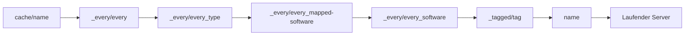

## Wie Templates funktionieren

Templates sind Ordner auf jedem Serverhost, die vor dem Serverstart in das Serververzeichnis kopiert werden. Nutze sie für Plugin-JARs, Standardwelten, Konfigurationsdateien und gemeinsame Ressourcen.

Der Standard-Setup-Workflow kopiert Template-Ebenen in einer festen Reihenfolge. Bestehende Dateien bleiben erhalten, solange du den Workflow nicht so anpasst, dass er sie überschreibt.



| Reihenfolge | Verzeichnis | Beschreibung |
| ----------- | ----------- | ------------ |
| 1 | `cache/{name}/` | Gecachte Dateien von vorherigen Starts |
| 2 | `_every/every/` | Basisdateien für alle Server |
| 3 | `_every/every_{type}/` | Typspezifische Dateien, zum Beispiel `every_proxy` oder `every_server` |
| 4 | `_every/every_{mapped-software}/` | Dateien für den plattformgemappten Software-Namen |
| 5 | `_every/every_{software}/` | Softwarespezifische Dateien, zum Beispiel `every_paper` oder `every_velocity` |
| 6 | `_tagged/{tag}/` | Dateien für jeden zugewiesenen Tag |
| 7 | `{name}/` | Dateien für eine Gruppe oder einen persistenten Server |

<Note>
  Brauchst du Welt- oder Spielerdaten, die Neustarts überleben? Verwende einen [Persistenten Server](/de/manual/setup/persistent-servers) anstelle einer Gruppe.
</Note>

## Template-Verzeichnisstruktur

<Tree>
  <Tree.Folder name="templates" defaultOpen>
    <Tree.Folder name="_every" defaultOpen>
      <Tree.Folder name="every">
        <Tree.File name="Wird auf alle Server angewendet" />
      </Tree.Folder>
      <Tree.Folder name="every_proxy">
        <Tree.File name="Wird auf alle Proxy-Server angewendet" />
      </Tree.Folder>
      <Tree.Folder name="every_server">
        <Tree.File name="Wird auf alle Game-Server angewendet" />
      </Tree.Folder>
      <Tree.Folder name="every_paper">
        <Tree.File name="Wird auf alle Paper-Server angewendet" />
      </Tree.Folder>
      <Tree.Folder name="every_velocity">
        <Tree.File name="Wird auf alle Velocity-Server angewendet" />
      </Tree.Folder>
    </Tree.Folder>
    <Tree.Folder name="_tagged" defaultOpen>
      <Tree.Folder name="minigames">
        <Tree.File name="Wird auf Server mit dem Tag minigames angewendet" />
      </Tree.Folder>
      <Tree.Folder name="premium">
        <Tree.File name="Wird auf Server mit dem Tag premium angewendet" />
      </Tree.Folder>
    </Tree.Folder>
    <Tree.Folder name="lobby">
      <Tree.File name="Wird auf die Gruppe oder den persistenten Server lobby angewendet" />
    </Tree.Folder>
    <Tree.Folder name="bedwars">
      <Tree.File name="Wird auf die Gruppe bedwars angewendet" />
    </Tree.Folder>
    <Tree.Folder name="cache">
      <Tree.File name="Verwaltete Cache-Dateien" />
    </Tree.Folder>
  </Tree.Folder>
</Tree>

## Gemeinsame Templates

### `_every/every`

Nutze `_every/every/` für Dateien, die jeder Server bekommen soll, also Proxies und Game-Server.

<Tree>
  <Tree.Folder name="templates" defaultOpen>
    <Tree.Folder name="_every" defaultOpen>
      <Tree.Folder name="every" defaultOpen>
        <Tree.Folder name="plugins">
          <Tree.File name="shared-plugin.jar" />
        </Tree.Folder>
      </Tree.Folder>
    </Tree.Folder>
  </Tree.Folder>
</Tree>

### `_every/every_{type}`

Nutze Typ-Templates, wenn Dateien für alle Proxies oder alle Game-Server gelten sollen.

| Verzeichnis | Verwendung |
| ----------- | ---------- |
| `_every/every_proxy/` | Proxy-Plugins und Proxy-Konfiguration |
| `_every/every_server/` | Game-Server-Plugins und gemeinsame Serverkonfiguration |

### `_every/every_{software}`

Nutze Software-Templates, wenn Dateien zu einer bestimmten Server-Software gehören.

| Verzeichnis | Verwendung |
| ----------- | ---------- |
| `_every/every_paper/` | Paper-spezifische Plugins und Konfiguration |
| `_every/every_spigot/` | Spigot-spezifische Plugins und Konfiguration |
| `_every/every_velocity/` | Velocity-spezifische Plugins und Konfiguration |

## Tagged Templates

Tags helfen dir, Dateien über mehrere Gruppen oder persistente Server zu teilen, ohne den benannten Template-Ordner zu duplizieren.

1. Erstelle einen Tag-Ordner in `templates/_tagged/`.
2. Weise denselben Tag im Dashboard zu, wenn du die Gruppe oder den persistenten Server erstellst oder bearbeitest.

<Tree>
  <Tree.Folder name="templates" defaultOpen>
    <Tree.Folder name="_tagged" defaultOpen>
      <Tree.Folder name="minigames" defaultOpen>
        <Tree.Folder name="plugins">
          <Tree.File name="minigame-core.jar" />
        </Tree.Folder>
      </Tree.Folder>
    </Tree.Folder>
  </Tree.Folder>
</Tree>

## Benannte Templates

Der Ordner mit dem Namen einer Gruppe oder eines persistenten Servers ist die spezifischste Template-Ebene.

<Tree>
  <Tree.Folder name="templates" defaultOpen>
    <Tree.Folder name="bedwars" defaultOpen>
      <Tree.Folder name="plugins">
        <Tree.File name="bedwars-plugin.jar" />
      </Tree.Folder>
      <Tree.Folder name="world">
        <Tree.File name="level.dat" />
        <Tree.Folder name="region" />
      </Tree.Folder>
    </Tree.Folder>
  </Tree.Folder>
</Tree>

Bei Gruppenservern werden Dateien, die während der Laufzeit geändert werden, entfernt, wenn der dynamische Server stoppt. Bei persistenten Servern bleibt das Laufzeitverzeichnis zwischen Neustarts erhalten.

## Template-Dateien verwalten

### Plugins hinzufügen

Lege Plugin-JARs in der Ebene ab, in der sie gelten sollen:

```bash
# Für alle Server
cp shared-plugin.jar templates/_every/every/plugins/

# Für alle Paper-Server
cp paper-plugin.jar templates/_every/every_paper/plugins/

# Für eine Gruppe oder einen persistenten Server
cp bedwars.jar templates/bedwars/plugins/
```

Neue Serverstarts enthalten das Plugin. Bereits laufende Server brauchen einen Neustart.

### Generierte Konfiguration zurück ins Template kopieren

1. Starte einen Server einmal, damit das Plugin seine Standarddateien erzeugt.
2. Stoppe den Server.
3. Kopiere die generierte Konfiguration aus `running/` in den passenden Template-Ordner.
4. Bearbeite die Template-Kopie.
5. Starte den Server erneut und prüfe das Ergebnis.

### Weltdateien hinzufügen

Lege einen Weltordner im benannten Template ab, wenn jeder neue dynamische Server mit derselben Map starten soll:

<Tree>
  <Tree.Folder name="templates" defaultOpen>
    <Tree.Folder name="bedwars" defaultOpen>
      <Tree.Folder name="world">
        <Tree.File name="level.dat" />
        <Tree.Folder name="region" />
      </Tree.Folder>
    </Tree.Folder>
  </Tree.Folder>
</Tree>

Änderungen während des Spielens gehen verloren, wenn ein dynamischer Gruppenserver stoppt. Nutze einen persistenten Server für Welten, an denen Spieler weiterbauen sollen.

## Cache-Dateien

Der Standard-Cleanup-Workflow speichert ausgewählte generierte Dateien in `templates/cache/{name}/`, damit spätere Starts sie wiederverwenden können. Der Serverhost verwaltet diesen Ordner.

<Tip>
  Wenn ein dynamischer Server mit veralteten generierten Dateien startet, stoppe die betroffenen Server und lösche den passenden Gruppenordner unter `templates/cache/`.
</Tip>

## Fehlerbehebung

<AccordionGroup>
  <Accordion title="Eine Datei wird nicht kopiert">
    Prüfe den genauen Ordnernamen. Die gemeinsamen Ordner liegen unter `_every/`, zum Beispiel `templates/_every/every_paper/`, nicht `templates/every_paper/`.
  </Accordion>

  <Accordion title="Eine Template-Änderung wirkt sich nicht auf einen laufenden Server aus">
    Templates werden während der Servervorbereitung kopiert. Starte den betroffenen Server neu, damit der Setup-Workflow erneut läuft.
  </Accordion>

  <Accordion title="Eine Datei wird nicht überschrieben">
    Der Standard-Setup-Workflow behält vorhandene Dateien in den meisten Template-Ebenen. Das schützt Cache- und Persistent-Server-Daten. Nutze einen Configurator oder einen eigenen Workflow, wenn ein Wert bei jedem Start erzwungen werden muss.
  </Accordion>

  <Accordion title="Ein Tag-Template wird nicht angewendet">
    Prüfe, ob der Tag im Dashboard zugewiesen ist und ob der Ordnername unter `templates/_tagged/` exakt zum Tag passt.
  </Accordion>
</AccordionGroup>
