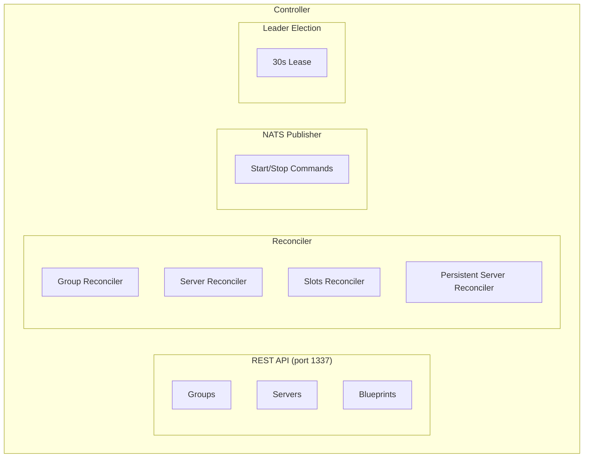
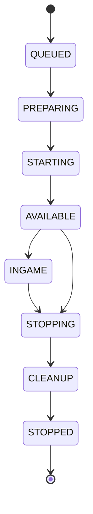

## What is the Controller?

The Controller is the brain of SimpleCloud - a distributed orchestration service that manages the desired state of your Minecraft infrastructure. It coordinates serverhosts, maintains configuration, and provides APIs for management.

## Key Responsibilities

### State Management

The Controller maintains the authoritative state of:

- **Networks** - Registered Minecraft networks with credentials
- **Blueprints** - Server configuration templates
- **Groups** - Scalable server collections with auto-scaling rules
- **Servers** - Running server instances and their status
- **Persistent Servers** - Long-running dedicated servers
- **Serverhosts** - Connected execution agents
- **Plugins** - Plugin definitions and assignments

### Reconciliation Loop

The Controller continuously reconciles desired state with actual state:

1. Every 5 seconds, compares configuration with running servers
2. Determines which servers need to start or stop
3. Selects optimal serverhosts based on capacity and preferences
4. Sends commands to serverhosts via NATS messaging
5. Processes status updates from serverhosts

### API Services

The Controller exposes a REST API on port 1337:

| Endpoint | Description |
|----------|-------------|
| `/v0/server-groups` | Group management |
| `/v0/servers` | Server operations |
| `/v0/persistent-servers` | Persistent server management |
| `/v0/blueprints` | Blueprint configuration |
| `/v0/serverhosts` | Serverhost registration |
| `/v0/plugins` | Plugin management |
| `/v0/networks` | Network registration |

API documentation is available at `http://localhost:1337/swagger/index.html`.

## Architecture



## Distributed Design

### Leader Election

Multiple controller instances can run simultaneously for high availability:

- Database-backed consensus with 30-second lease
- Only the leader performs network assignments and critical operations
- Automatic failover if leader becomes unavailable
- All instances can serve API requests

### Network Assignment

Networks are distributed across controllers:

- Each network is assigned to one controller for lifecycle management
- Assignment considers controller load and serverhost connectivity
- Automatic reassignment if a controller becomes inactive

## Server Lifecycle

Servers follow this state machine:



| State | Description |
|-------|-------------|
| `QUEUED` | Waiting to be scheduled |
| `PREPARING` | Serverhost preparing files |
| `STARTING` | Server process starting |
| `AVAILABLE` | Ready for players |
| `INGAME` | Running with players |
| `STOPPING` | Graceful shutdown |
| `CLEANUP` | Removing resources |
| `STOPPED` | Server terminated |

## Auto-Scaling

The Controller supports automatic scaling based on:

### Slot-Based Scaling

Scale based on total available player slots:

```yaml
scaling:
  mode: SLOTS
  min_servers: 1
  max_servers: 5
  player_threshold: 0.8  # Scale up when 80% full
```

### Server-Based Scaling

Maintain a fixed number of servers:

```yaml
scaling:
  mode: SERVER
  min_servers: 2
  max_servers: 2
```

## Communication

### NATS Topics

The Controller uses NATS for serverhost communication:

| Topic Pattern | Purpose |
|--------------|---------|
| `{networkId}.serverhost.{id}.start` | Start server request |
| `{networkId}.server.{id}.status` | Server status updates |
| `{networkId}.server.{id}.stopped` | Server stopped events |
| `{networkId}.internal.serverhost.{id}.keep-alive` | Health checks |

### Keep-Alive Protocol

Serverhosts send periodic keep-alive messages:

- Controller tracks last heartbeat per serverhost
- Inactive serverhosts are marked unavailable
- Controller can request serverhost updates

## Infrastructure Requirements

| Component | Purpose | Required |
|-----------|---------|----------|
| PostgreSQL | State persistence | Yes |
| NATS | Serverhost messaging | Yes |
| Valkey/Redis | Metrics caching | Optional |
| ClickHouse | Log storage | Optional |

## Accessing the Controller

### Via CLI

```bash
# Check controller status
sc status

# View controller logs
sc logs controller

# Attach to controller console
sc attach controller
```

### Via API

```bash
# List all groups
curl -H "X-Network-ID: your-network" \
     -H "X-Network-Secret: your-secret" \
     http://localhost:1337/v0/server-groups

# Start a server
curl -X POST \
     -H "X-Network-ID: your-network" \
     -H "X-Network-Secret: your-secret" \
     -H "Content-Type: application/json" \
     -d '{"group_id": "lobby"}' \
     http://localhost:1337/v0/servers
```

## High Availability

For production deployments:

- Run multiple controller instances behind a load balancer
- Use managed PostgreSQL with replication
- Configure NATS clustering for message reliability
- Enable Valkey/Redis for distributed caching

<Note>
  The Controller must be running for new servers to start. Existing servers
  continue running if the Controller temporarily goes offline.
</Note>
