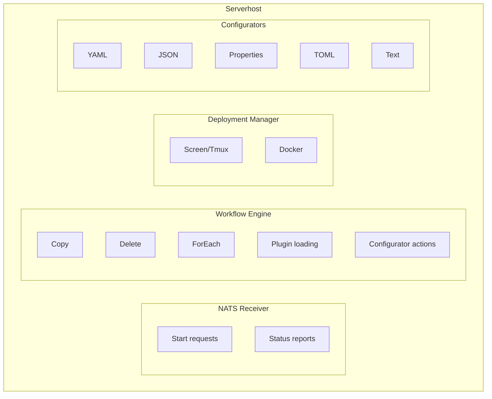
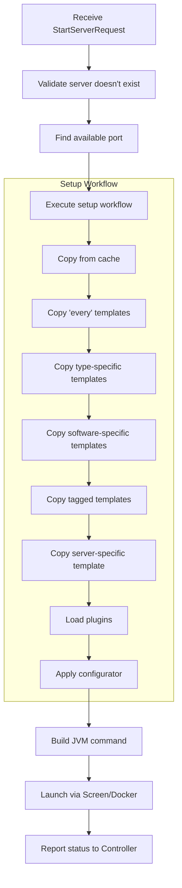

## What is the Serverhost?

The Serverhost is a distributed execution agent that runs on each machine in your SimpleCloud infrastructure. It receives commands from the Controller and manages the actual lifecycle of Minecraft servers - from preparation to execution to cleanup.

## Key Responsibilities

### Server Lifecycle

The Serverhost manages the complete server lifecycle:

1. **Preparation** - Execute workflows, copy templates, install plugins
2. **Configuration** - Apply configurators to set ports, secrets, etc.
3. **Execution** - Launch the server process (Screen/Tmux or Docker)
4. **Monitoring** - Track server health and stream logs
5. **Cleanup** - Stop process and remove temporary files

### Workflow Execution

Workflows define the server preparation process:

- Copy template files to server directory
- Download and install plugins from registries
- Apply configuration based on server software
- Execute custom setup steps

### Plugin Management

Automatic plugin installation from multiple sources:

| Source | Description |
|--------|-------------|
| Modrinth | Modern plugin/mod registry |
| Hangar | PaperMC's plugin repository |
| Spigot | SpigotMC resource pages |
| URL | Direct download from any HTTP(S) URL |

## Architecture



## Execution Modes

### Screen/Tmux (Local)

The default execution mode using terminal multiplexers:

- **Screen** - Preferred, widely available on Linux
- **Tmux** - Alternative if Screen is unavailable

Servers run as detached processes with console access via:

```bash
# Attach to a server console
sc attach <server-name>
```

### Docker

Container-based execution for isolation:

- Each server runs in its own container
- Resource limits enforced by Docker
- Better isolation between servers
- Requires Docker to be installed

Configure the runner mode when starting:

```bash
sc start --runner docker
sc start --runner screen
```

## Directory Structure

<Tree>
  <Tree.Folder name="secrets" defaultOpen>
    <Tree.File name="network-id.key" />
    <Tree.File name="network-secret.key" />
    <Tree.File name="serverhost-id.key" />
  </Tree.Folder>
  <Tree.Folder name="workflows" defaultOpen>
    <Tree.Folder name="internal" defaultOpen>
      <Tree.File name="setup.yml" />
      <Tree.File name="cleanup.yml" />
    </Tree.Folder>
  </Tree.Folder>
  <Tree.Folder name="options" defaultOpen>
    <Tree.Folder name="configurators">
      <Tree.File name="paper_velocity.yml" />
      <Tree.File name="velocity.yml" />
    </Tree.Folder>
    <Tree.File name="modrinth-platform-mappings.yml" />
  </Tree.Folder>
  <Tree.Folder name="templates" defaultOpen>
    <Tree.Folder name="every" />
    <Tree.Folder name="every_proxy" />
    <Tree.Folder name="every_server" />
    <Tree.Folder name="every_paper" />
    <Tree.Folder name="every_velocity" />
    <Tree.Folder name="_tagged">
      <Tree.Folder name="minigames" />
    </Tree.Folder>
    <Tree.Folder name="cache" />
  </Tree.Folder>
  <Tree.Folder name="running" />
  <Tree.Folder name="logs" />
</Tree>

## Template Hierarchy

Templates are applied in a specific order, with later templates overwriting earlier ones. See [Templates](/en/manual/setup/templates) for full details and examples.

## Communication

### NATS Messaging

The Serverhost communicates with the Controller via NATS:

**Inbound (from Controller):**
- `{networkId}.serverhost.{id}.start` - Start server request

**Outbound (to Controller):**
- `{networkId}.server.{id}.status` - Server status updates
- `{networkId}.server.{id}.logs` - Log streaming
- `{networkId}.internal.serverhost.{id}.keep-alive` - Health checks

### State Synchronization

Every minute, the Serverhost:

1. Fetches active servers from Controller
2. Compares with locally running servers
3. Stops orphaned servers not in Controller's state

## Server Preparation Flow

When a start request arrives:



## Configuration

Serverhost configuration via CLI parameters:

| Parameter | Description | Default |
|-----------|-------------|---------|
| `--network-id` | Network identifier | From env |
| `--controller-url` | Controller API URL | platform.simplecloud.app |
| `--nats-url` | NATS server URL | platform.simplecloud.app |
| `--deployment-type` | Execution mode | `local` |
| `--port-range` | Available port range | `25565-25665` |
| `--multiplexer` | Screen or Tmux | Auto-detect |

## Monitoring

### Via CLI

```bash
# Check serverhost status
sc status serverhost

# View serverhost logs
sc logs serverhost

# View specific server logs
sc server logs <group> <id>
```

### Keep-Alive

The Serverhost sends periodic keep-alive messages:

- Reports current version
- Receives update notifications
- Maintains connection with Controller

<Note>
  Serverhosts automatically restart servers if the Serverhost itself restarts,
  based on synchronization with the Controller's state.
</Note>

## Related Topics

- [Configurators](/en/manual/configuration/configurators) - Server configuration system
- [Workflows](/en/manual/configuration/workflows) - Server preparation workflows
