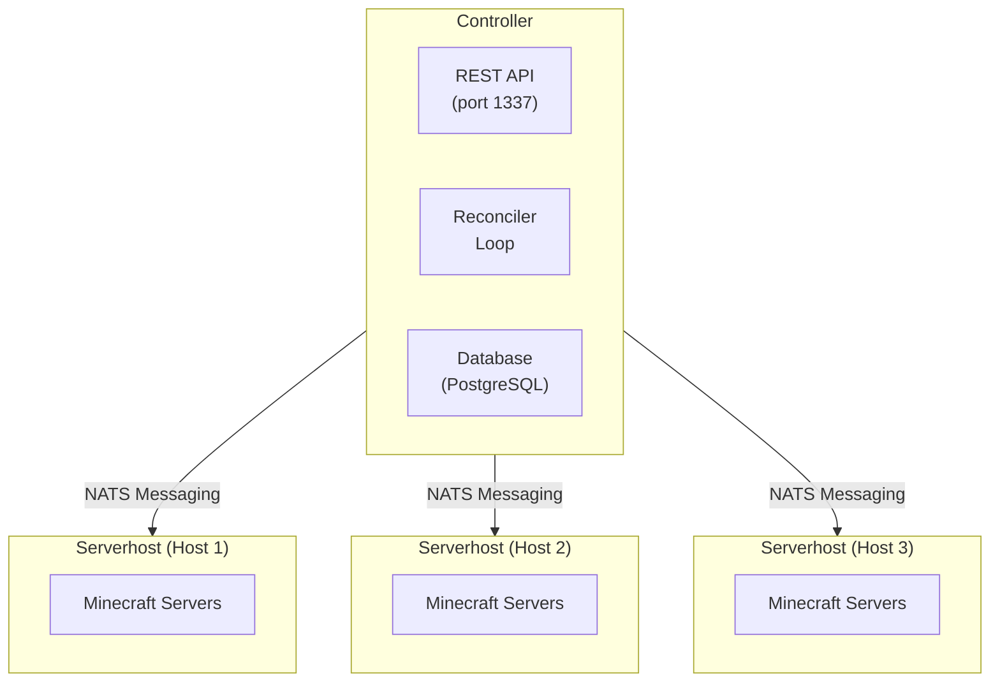

## Understanding SimpleCloud v3

SimpleCloud v3 is built on a distributed microservices architecture designed for scalability and reliability. The system separates orchestration (Controller) from execution (Serverhost), enabling you to scale your Minecraft infrastructure across multiple machines.

## Core Components

### Controller

The [Controller](/en/manual/architecture/controller) is the central orchestration service that:

- Manages the desired state of your infrastructure
- Handles groups, blueprints, servers, and persistent servers
- Provides REST APIs for management and integration
- Coordinates serverhosts via NATS messaging
- Supports horizontal scaling with leader election

### Serverhost

The [Serverhost](/en/manual/architecture/serverhost) is the execution agent that:

- Runs on each machine hosting Minecraft servers
- Manages server lifecycle (preparation, start, stop, cleanup)
- Executes workflows for server setup
- Supports multiple runners (Screen/Tmux, Docker)
- Handles plugin installation and configuration

### CLI

The [CLI](/en/manual/architecture/cli) provides:

- Interactive setup and configuration
- Component lifecycle management
- Group and server management
- Context switching for multiple environments

## Architecture Diagram

## Key Concepts

### Blueprints

Blueprints are server templates that define:

- Minecraft version and server software (Paper, Velocity, etc.)
- Runtime configuration (Java version, JVM arguments)
- Workflow steps for server preparation
- Configurator settings

Blueprints are reusable - multiple groups can reference the same blueprint.

### Groups

Groups define scalable collections of servers with:

- Resource allocation (memory, max players)
- Auto-scaling rules (min/max servers, player threshold)
- Deployment strategy (which serverhosts to use)
- Reference to a blueprint or container image

### Servers

Servers are individual running instances:

- Created dynamically from groups based on scaling rules
- Have unique identifiers and assigned ports
- Report metrics (player count, memory usage)
- Follow a lifecycle: Queued → Preparing → Starting → Available → Stopping

### Persistent Servers

Persistent servers are long-running instances that:

- Maintain state across restarts
- Are pinned to specific serverhosts
- Don't scale automatically
- Ideal for survival worlds, build servers, or lobbies with persistent data

### Plugins

Plugins can be assigned to groups or persistent servers:

- Automatic download from Modrinth, Hangar, or Spigot
- Version and platform-aware installation
- Cached for faster server startup

## Data Flow

1. **Configuration**: You define blueprints, groups, and plugins via CLI or API
2. **Reconciliation**: Controller compares desired state with actual state every 5 seconds
3. **Scheduling**: Controller determines which servers to start/stop and on which serverhost
4. **Communication**: Controller sends requests to serverhosts via NATS
5. **Execution**: Serverhost prepares and launches the server
6. **Reporting**: Serverhost reports server status back to controller

## Infrastructure

SimpleCloud uses these infrastructure components:

| Component | Purpose |
|-----------|---------|
| PostgreSQL | Persistent state storage |
| NATS | Message broker for serverhost communication |
| Valkey/Redis | Metrics caching (optional) |
| ClickHouse | Log and metrics storage (optional) |

## Next Steps

- [Controller](/en/manual/architecture/controller) - Deep dive into the orchestration service
- [Serverhost](/en/manual/architecture/serverhost) - Learn about server execution
- [CLI](/en/manual/architecture/cli) - Explore command-line management
