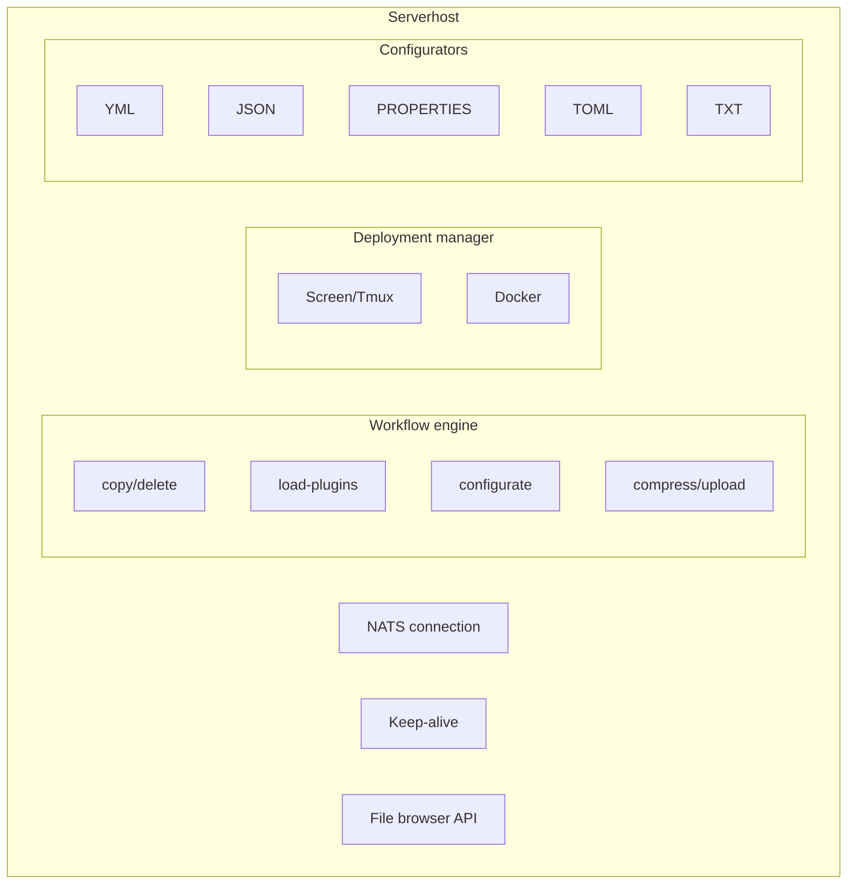
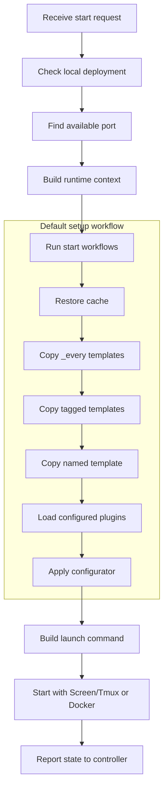

## What the serverhost does

The serverhost runs on every machine that should start Minecraft servers for your SimpleCloud network. It connects to the controller, receives start requests, prepares server files, launches the server process, reports state, and cleans up after dynamic servers stop.

## Responsibilities

### Server lifecycle

The serverhost owns the local lifecycle of each server:

1. **Preparation** - Run start workflows, copy templates, and load configured plugins
2. **Configuration** - Apply configurators for ports, forwarding secrets, player limits, and related files
3. **Execution** - Launch the server with the configured runner
4. **Monitoring** - Track the local process, stream logs, and report state changes
5. **Cleanup** - Run stop workflows and remove temporary dynamic server directories

### Workflow execution

Workflows define the preparation and cleanup steps. The default setup workflow copies cache data, shared templates, tag templates, and the named template before it loads plugins and applies the selected configurator.

### Plugin loading

The serverhost can load configured plugins from multiple sources:

| Source | Description |
| ------ | ----------- |
| Modrinth | Plugin or mod versions from Modrinth |
| Hangar | PaperMC Hangar projects |
| Spigot | SpigotMC resources |
| URL | Direct HTTP(S) download |

## Architecture



## Runner modes

### Screen or Tmux

The local runner starts servers as detached processes through a terminal multiplexer.

```bash
sc start --runner screen
```

Use `sc attach serverhost` to attach to the serverhost component console.

### Docker

The Docker runner starts each server in its own container. Use it when you want stronger process isolation and Docker-managed resource limits.

```bash
sc start --runner docker
```

Docker must be installed on the serverhost machine.

## Directory structure

<Tree>
  <Tree.Folder name="secrets" defaultOpen>
    <Tree.File name="network-id.key" />
    <Tree.File name="network-secret.key" />
    <Tree.File name="serverhost-id.key" />
  </Tree.Folder>
  <Tree.Folder name="options" defaultOpen>
    <Tree.Folder name="configurators">
      <Tree.File name="paper_velocity.yml" />
      <Tree.File name="velocity.yml" />
    </Tree.Folder>
    <Tree.File name="platform-mappings.yml" />
  </Tree.Folder>
  <Tree.Folder name="workflows" defaultOpen>
    <Tree.Folder name="internal">
      <Tree.File name="setup.yml" />
      <Tree.File name="cleanup.yml" />
    </Tree.Folder>
  </Tree.Folder>
  <Tree.Folder name="templates" defaultOpen>
    <Tree.Folder name="_every">
      <Tree.Folder name="every" />
      <Tree.Folder name="every_proxy" />
      <Tree.Folder name="every_server" />
      <Tree.Folder name="every_paper" />
      <Tree.Folder name="every_velocity" />
    </Tree.Folder>
    <Tree.Folder name="_tagged">
      <Tree.Folder name="minigames" />
    </Tree.Folder>
    <Tree.Folder name="lobby" />
    <Tree.Folder name="cache" />
  </Tree.Folder>
  <Tree.Folder name="running" />
  <Tree.Folder name="logs" />
</Tree>

## Server preparation flow

When a start request arrives:



Dynamic group servers use temporary directories under `running/`. Persistent servers keep their runtime directory between restarts.

## Communication

The serverhost communicates with the controller through NATS and controller HTTP APIs:

| Channel | Purpose |
| ------- | ------- |
| Start requests | The controller asks a specific serverhost to deploy a server |
| Keep-alive | The serverhost reports version, uptime, and installed Java versions |
| Server events | The serverhost reports starting, stopped, and cleanup-complete events |
| Log forwarding | The serverhost forwards server logs for dashboard and CLI views |
| File browser API | The dashboard can browse and edit allowed serverhost files |

Every serverhost also synchronizes controller state and stops orphaned local servers that no longer belong to the controller state.

## Setup options

Serverhost setup uses the current CLI setup options:

| Option | Description |
| ------ | ----------- |
| `--network` | Network ID or slug |
| `--install-dir` | Serverhost installation directory |
| `--host-name` | Serverhost display name |
| `--max-memory` | Maximum memory available for server processes, such as `80%` or `32gb` |
| `--start` / `--no-start` | Start SimpleCloud after setup or skip startup |
| `--auto-install-deps` / `--no-auto-install-deps` | Install required dependencies automatically or skip dependency installation |
| `--install` | Install setup installables, such as `--install java:21` |
| `-y, --yes` | Use non-interactive defaults where possible |

## Monitoring

```bash
# Check serverhost status
sc status serverhost

# View serverhost logs
sc logs serverhost

# View a server log
sc server logs <group> <id>
```

<Note>
  When a serverhost restarts, it compares local deployments with the controller state and reattaches to servers it still owns where possible.
</Note>

## Related topics

- [Templates](/en/manual/setup/templates) - Template hierarchy and file layout
- [Configurators](/en/manual/configuration/configurators) - Server configuration system
- [Workflows](/en/manual/configuration/workflows) - Server preparation and cleanup workflows
