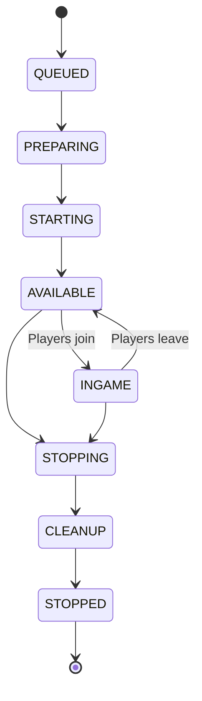

## How Servers are Created

Every server belongs to either a [Group](/en/manual/setup/server-groups) or a [Persistent Server](/en/manual/setup/persistent-servers).

### From Groups

Groups create servers automatically based on player demand:

- Auto-scaling spins up new servers when players join and removes idle ones when demand drops
- Minimum count ensures servers are always available, even with no players
- Multiple instances run simultaneously (Lobby-1, Lobby-2, Lobby-3, etc.)
- You can also manually start additional servers when needed

### From Persistent Servers

Persistent servers are single instances that don't scale:

- Always the same server - just on or off
- Maintains its world and data between restarts
- Ideal for gamemodes like Skyblock, SMP, or Citybuild

## Server Lifecycle

Every server progresses through these states:

| State | Description |
|-------|-------------|
| **Queued** | Waiting for a server host to be assigned |
| **Preparing** | Template files being copied to the runtime directory |
| **Starting** | JVM process launching, plugins loading |
| **Available** | Ready for players, registered with proxy |
| **Ingame** | Has active players connected |
| **Stopping** | Graceful shutdown in progress |
| **Cleanup** | Runtime files and workflow cleanup are being handled |
| **Stopped** | Process terminated, runtime cleaned up |

## Server Properties

- Each server inherits properties from its group or persistent server configuration
- Instance-specific property overrides are possible at runtime
- Properties are available to plugins as environment variables on the running server

## Server Host Allocation

Servers don't run in a vacuum - they're assigned to server hosts:

- The controller assigns servers to hosts based on deployment settings
- Priority order determines which host is preferred when multiple are available
- Each server runs in its own isolated directory on the host
