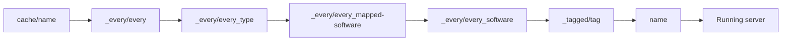

## How templates work

Templates are folders on each serverhost that are copied into a server directory before the server starts. Use them for plugin JARs, default worlds, configuration files, and shared resources.

The default setup workflow copies template layers in a fixed order. Existing files are kept unless you customize the workflow to overwrite them.



| Order | Directory | Description |
| ----- | --------- | ----------- |
| 1 | `cache/{name}/` | Cached files from previous starts |
| 2 | `_every/every/` | Base files for all servers |
| 3 | `_every/every_{type}/` | Type-specific files, such as `every_proxy` or `every_server` |
| 4 | `_every/every_{mapped-software}/` | Platform-mapped software files |
| 5 | `_every/every_{software}/` | Software-specific files, such as `every_paper` or `every_velocity` |
| 6 | `_tagged/{tag}/` | Files for each assigned tag |
| 7 | `{name}/` | Files for one group or persistent server |

<Note>
  Need world or player data to survive restarts? Use a [Persistent Server](/en/manual/setup/persistent-servers) instead of a group.
</Note>

## Template directory structure

<Tree>
  <Tree.Folder name="templates" defaultOpen>
    <Tree.Folder name="_every" defaultOpen>
      <Tree.Folder name="every">
        <Tree.File name="Applied to all servers" />
      </Tree.Folder>
      <Tree.Folder name="every_proxy">
        <Tree.File name="Applied to all proxy servers" />
      </Tree.Folder>
      <Tree.Folder name="every_server">
        <Tree.File name="Applied to all game servers" />
      </Tree.Folder>
      <Tree.Folder name="every_paper">
        <Tree.File name="Applied to all Paper servers" />
      </Tree.Folder>
      <Tree.Folder name="every_velocity">
        <Tree.File name="Applied to all Velocity servers" />
      </Tree.Folder>
    </Tree.Folder>
    <Tree.Folder name="_tagged" defaultOpen>
      <Tree.Folder name="minigames">
        <Tree.File name="Applied to servers with the minigames tag" />
      </Tree.Folder>
      <Tree.Folder name="premium">
        <Tree.File name="Applied to servers with the premium tag" />
      </Tree.Folder>
    </Tree.Folder>
    <Tree.Folder name="lobby">
      <Tree.File name="Applied to the lobby group or persistent server" />
    </Tree.Folder>
    <Tree.Folder name="bedwars">
      <Tree.File name="Applied to the bedwars group" />
    </Tree.Folder>
    <Tree.Folder name="cache">
      <Tree.File name="Managed cache files" />
    </Tree.Folder>
  </Tree.Folder>
</Tree>

## Shared templates

### `_every/every`

Use `_every/every/` for files every server should receive, including proxies and game servers.

<Tree>
  <Tree.Folder name="templates" defaultOpen>
    <Tree.Folder name="_every" defaultOpen>
      <Tree.Folder name="every" defaultOpen>
        <Tree.Folder name="plugins">
          <Tree.File name="shared-plugin.jar" />
        </Tree.Folder>
      </Tree.Folder>
    </Tree.Folder>
  </Tree.Folder>
</Tree>

### `_every/every_{type}`

Use type templates when a file should apply to all proxies or all game servers.

| Directory | Use for |
| --------- | ------- |
| `_every/every_proxy/` | Proxy plugins and proxy configuration |
| `_every/every_server/` | Game server plugins and shared server configuration |

### `_every/every_{software}`

Use software templates when a file belongs to a specific server software.

| Directory | Use for |
| --------- | ------- |
| `_every/every_paper/` | Paper-specific plugins and configuration |
| `_every/every_spigot/` | Spigot-specific plugins and configuration |
| `_every/every_velocity/` | Velocity-specific plugins and configuration |

## Tagged templates

Tags let you share files across multiple groups or persistent servers without duplicating their named template folder.

1. Create a tag folder in `templates/_tagged/`.
2. Add the same tag in the dashboard when you create or edit the group or persistent server.

<Tree>
  <Tree.Folder name="templates" defaultOpen>
    <Tree.Folder name="_tagged" defaultOpen>
      <Tree.Folder name="minigames" defaultOpen>
        <Tree.Folder name="plugins">
          <Tree.File name="minigame-core.jar" />
        </Tree.Folder>
      </Tree.Folder>
    </Tree.Folder>
  </Tree.Folder>
</Tree>

## Named templates

The folder named after a group or persistent server is the most specific template layer.

<Tree>
  <Tree.Folder name="templates" defaultOpen>
    <Tree.Folder name="bedwars" defaultOpen>
      <Tree.Folder name="plugins">
        <Tree.File name="bedwars-plugin.jar" />
      </Tree.Folder>
      <Tree.Folder name="world">
        <Tree.File name="level.dat" />
        <Tree.Folder name="region" />
      </Tree.Folder>
    </Tree.Folder>
  </Tree.Folder>
</Tree>

For group servers, files changed while the server is running are removed when the dynamic server stops. For persistent servers, the runtime directory is kept between restarts.

## Managing template files

### Add plugins

Place plugin JARs in the layer where they should apply:

```bash
# For all servers
cp shared-plugin.jar templates/_every/every/plugins/

# For all Paper servers
cp paper-plugin.jar templates/_every/every_paper/plugins/

# For one group or persistent server
cp bedwars.jar templates/bedwars/plugins/
```

New server starts include the plugin. Already-running servers need a restart.

### Move generated configuration back into a template

1. Start a server once so the plugin creates its default files.
2. Stop the server.
3. Copy the generated configuration from `running/` into the matching template folder.
4. Edit the template copy.
5. Start the server again to verify the result.

### Add world files

Place a world folder in the named template when each new dynamic server should start from the same map:

<Tree>
  <Tree.Folder name="templates" defaultOpen>
    <Tree.Folder name="bedwars" defaultOpen>
      <Tree.Folder name="world">
        <Tree.File name="level.dat" />
        <Tree.Folder name="region" />
      </Tree.Folder>
    </Tree.Folder>
  </Tree.Folder>
</Tree>

Changes made during gameplay are lost when a dynamic group server stops. Use a persistent server for worlds that players should keep building on.

## Cache files

The default cleanup workflow stores selected generated files in `templates/cache/{name}/` so later starts can reuse them. The serverhost manages this folder.

<Tip>
  If a dynamic server starts with stale generated files, stop the affected servers and clear that group's folder under `templates/cache/`.
</Tip>

## Troubleshooting

<AccordionGroup>
  <Accordion title="A file is not copied">
    Check the exact folder name. The shared folders live under `_every/`, for example `templates/_every/every_paper/`, not `templates/every_paper/`.
  </Accordion>

  <Accordion title="A template change does not affect a running server">
    Templates are copied during server preparation. Restart the affected server so the setup workflow runs again.
  </Accordion>

  <Accordion title="A file is not overwritten">
    The default setup workflow keeps existing files for most template layers. This protects cache and persistent-server data. Use a configurator or a custom workflow when a value must be enforced on every start.
  </Accordion>

  <Accordion title="A tag template does not apply">
    Make sure the tag is assigned in the dashboard and that the folder name under `templates/_tagged/` matches the tag exactly.
  </Accordion>
</AccordionGroup>
