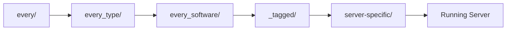

Templates are the file structures that get copied to new server instances. They contain your server's plugins, configurations, and any default world files.

## How Templates Work

When SimpleCloud starts a server, templates are applied in a specific order. Each layer can add or overwrite files from previous layers, giving you flexible control over your server configurations.



<Note>
  Need persistent data that survives restarts? Use a [Persistent Server](/en/manual/setup/persistent-servers) instead of a group.
</Note>

## Template Directory Structure

<Tree>
  <Tree.Folder name="templates" defaultOpen>
    <Tree.Folder name="every" defaultOpen>
      <Tree.File name="Applied to ALL servers" />
    </Tree.Folder>
    <Tree.Folder name="every_proxy">
      <Tree.File name="Applied to all proxy servers" />
    </Tree.Folder>
    <Tree.Folder name="every_server">
      <Tree.File name="Applied to all game servers" />
    </Tree.Folder>
    <Tree.Folder name="every_paper">
      <Tree.File name="Applied to all Paper servers" />
    </Tree.Folder>
    <Tree.Folder name="every_velocity">
      <Tree.File name="Applied to all Velocity servers" />
    </Tree.Folder>
    <Tree.Folder name="_tagged" defaultOpen>
      <Tree.Folder name="minigames">
        <Tree.File name="Applied to servers with 'minigames' tag" />
      </Tree.Folder>
      <Tree.Folder name="premium">
        <Tree.File name="Applied to servers with 'premium' tag" />
      </Tree.Folder>
    </Tree.Folder>
    <Tree.Folder name="lobby">
      <Tree.File name="Applied only to 'lobby' group" />
    </Tree.Folder>
    <Tree.Folder name="bedwars">
      <Tree.File name="Applied only to 'bedwars' group" />
    </Tree.Folder>
    <Tree.Folder name="cache">
      <Tree.File name="Cached files for faster restarts" />
    </Tree.Folder>
  </Tree.Folder>
</Tree>

## Template Hierarchy

Templates are applied in order. Later templates overwrite earlier ones:

| Order | Directory | Description |
|-------|-----------|-------------|
| 1 | `every/` | Base files for all servers |
| 2 | `every_{type}/` | Type-specific (`every_proxy/`, `every_server/`) |
| 3 | `every_{software}/` | Software-specific (`every_paper/`, `every_velocity/`) |
| 4 | `_tagged/{tag}/` | Tag-based templates |
| 5 | `{group-name}/` | Group-specific templates |
| 6 | `cache/{group}/` | Cached files from previous runs |

### Example: How a Lobby Server Gets Built

For a server in the `lobby` group with Paper software and the `premium` tag:

1. **`every/`** - Base plugins like SimpleCloud-Plugin
2. **`every_server/`** - Common server configs (not proxy)
3. **`every_paper/`** - Paper-specific settings
4. **`_tagged/premium/`** - Premium-only plugins/configs
5. **`lobby/`** - Lobby-specific world and plugins

## Base Template: `every/`

The `every/` folder contains files applied to **all servers** - proxies and game servers alike. Use this for:

- SimpleCloud plugins that every server needs
- Universal configuration files
- Shared resources

<Tree>
  <Tree.Folder name="templates" defaultOpen>
    <Tree.Folder name="every" defaultOpen>
      <Tree.Folder name="plugins" defaultOpen>
        <Tree.File name="simplecloud-plugin.jar" />
      </Tree.Folder>
    </Tree.Folder>
  </Tree.Folder>
</Tree>

## Type Templates: `every_{type}/`

Apply files based on server type:

- **`every_proxy/`** - All proxy servers (Velocity, BungeeCord)
- **`every_server/`** - All game servers (Paper, Spigot, etc.)

<Tree>
  <Tree.Folder name="templates" defaultOpen>
    <Tree.Folder name="every_proxy" defaultOpen>
      <Tree.Folder name="plugins" defaultOpen>
        <Tree.File name="proxy-essentials.jar" />
      </Tree.Folder>
    </Tree.Folder>
    <Tree.Folder name="every_server" defaultOpen>
      <Tree.Folder name="plugins" defaultOpen>
        <Tree.File name="worldedit.jar" />
      </Tree.Folder>
    </Tree.Folder>
  </Tree.Folder>
</Tree>

## Software Templates: `every_{software}/`

Apply files based on server software:

- **`every_paper/`** - All Paper servers
- **`every_velocity/`** - All Velocity proxies
- **`every_spigot/`** - All Spigot servers

<Tree>
  <Tree.Folder name="templates" defaultOpen>
    <Tree.Folder name="every_paper" defaultOpen>
      <Tree.Folder name="plugins" defaultOpen>
        <Tree.File name="paper-specific-plugin.jar" />
      </Tree.Folder>
    </Tree.Folder>
  </Tree.Folder>
</Tree>

## Tagged Templates: `_tagged/{tag}/`

Tags let you share configurations across multiple groups. Assign tags to groups, and any server in those groups gets the tagged template applied.

### Setting Up Tags

1. Create a tag folder in `templates/_tagged/`:

<Tree>
  <Tree.Folder name="templates" defaultOpen>
    <Tree.Folder name="_tagged" defaultOpen>
      <Tree.Folder name="minigames" defaultOpen>
        <Tree.Folder name="plugins" defaultOpen>
          <Tree.File name="minigame-core.jar" />
        </Tree.Folder>
      </Tree.Folder>
      <Tree.Folder name="premium" defaultOpen>
        <Tree.Folder name="plugins" defaultOpen>
          <Tree.File name="premium-features.jar" />
        </Tree.Folder>
      </Tree.Folder>
    </Tree.Folder>
  </Tree.Folder>
</Tree>

2. Assign tags to your groups via CLI or API when creating/updating the group.

### Use Cases for Tags

| Tag | Purpose |
|-----|---------|
| `minigames` | Shared minigame plugins (BedWars, SkyWars, etc.) |
| `premium` | Premium-only features |
| `development` | Debug plugins for dev servers |
| `pvp` | Combat-related plugins |

## Group-Specific Templates

The traditional template folder named after your group:

<Tree>
  <Tree.Folder name="templates" defaultOpen>
    <Tree.Folder name="bedwars" defaultOpen>
      <Tree.Folder name="plugins" defaultOpen>
        <Tree.File name="bedwars-plugin.jar" />
      </Tree.Folder>
      <Tree.Folder name="world" defaultOpen>
        <Tree.File name="level.dat" />
        <Tree.Folder name="region" />
      </Tree.Folder>
    </Tree.Folder>
  </Tree.Folder>
</Tree>

This is the most specific level - files here override everything else.

## Managing Templates

### Adding Plugins

Place plugin JARs in the appropriate template folder:

```bash
# For all servers
cp simplecloud-plugin.jar templates/every/plugins/

# For all Paper servers
cp paper-plugin.jar templates/every_paper/plugins/

# For a specific group
cp bedwars.jar templates/bedwars/plugins/
```

New servers will include the plugin. Existing servers need a restart.

### Configuring Plugins

1. Start a server once to generate default configs
2. Stop the server
3. Copy configs from the `running/` directory back to your template
4. Edit as needed

### World Files

Place world folders in the template for a default map:

<Tree>
  <Tree.Folder name="templates" defaultOpen>
    <Tree.Folder name="bedwars" defaultOpen>
      <Tree.Folder name="world" defaultOpen>
        <Tree.File name="level.dat" />
        <Tree.Folder name="region" />
      </Tree.Folder>
    </Tree.Folder>
  </Tree.Folder>
</Tree>

Every new server starts with this world. Changes during gameplay are lost when the server stops.

## Caching

SimpleCloud caches certain files to speed up server starts:

- Plugin remapping data (Paper)
- Downloaded dependencies
- Generated files

The cache is stored in `templates/cache/{group}/` and automatically managed.

<Note>
  If you're having issues with outdated files, you can clear the cache folder for a group to force a fresh setup.
</Note>

## When to Use Each Template Level

| Template Level | Use For |
|----------------|---------|
| `every/` | Plugins needed on every server |
| `every_{type}/` | Proxy-only or server-only plugins |
| `every_{software}/` | Software-specific plugins/configs |
| `_tagged/` | Shared features across multiple groups |
| `{group}/` | Group-specific files and worlds |

## Templates and Persistent Servers

Templates are used for **both** group servers and persistent servers. The workflow runs on every server start, applying templates in the hierarchy order.

### Key Difference

| Aspect | Group Servers | Persistent Servers |
|--------|---------------|-------------------|
| Directory | Created fresh, deleted on stop | Permanent, survives restarts |
| Template application | Overwrites everything | Merges with existing files |
| World data | Lost on stop | Kept between restarts |
| Use case | Minigames, lobbies | SMP, Skyblock, builds |

### How It Works for Persistent Servers

On each restart of a persistent server:

1. The workflow runs and applies templates
2. New files from templates are added
3. Existing files in the server directory are **not overwritten** (unless `replace: true`)
4. World data and player data remain intact

<Warning>
  If you update a plugin in your template, the persistent server won't automatically get the new version unless you manually delete the old plugin from the server's directory.
</Warning>

### When to Use What

| Scenario | Recommendation |
|----------|----------------|
| Minigames (BedWars, SkyWars) | Group - fresh map each game |
| Lobby servers | Group - no persistent data needed |
| Proxies | Group - configuration only |
| Skyblock, SMP, Citybuild | [Persistent Server](/en/manual/setup/persistent-servers) - keeps world data |
